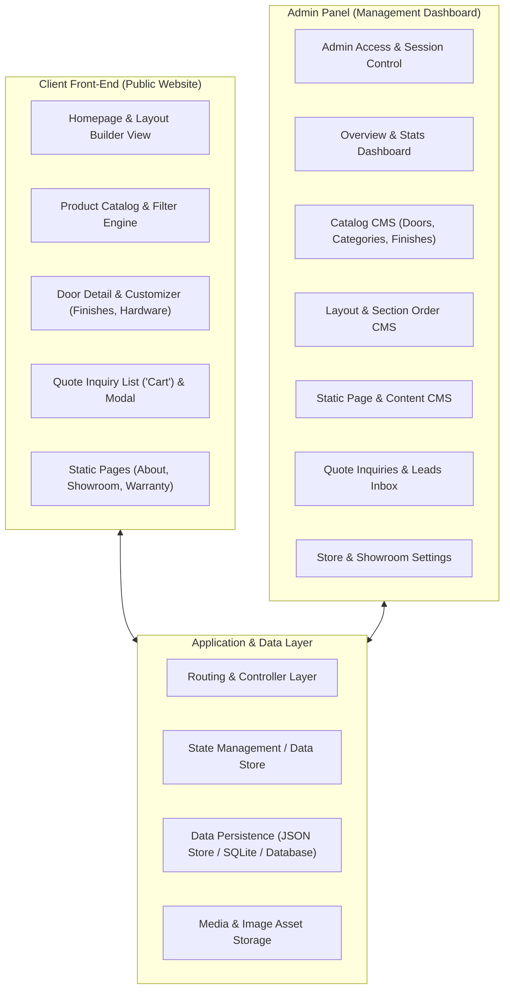

# Architecture Documentation: Modern Architectural Doors Catalog & CMS Platform

## 1. Project Overview & Vision
This platform is a modern, high-performance web catalog and Content Management System (CMS) inspired by industry leaders in architectural interior and exterior doors:
- **Doors Los Angeles** ([doorslosangeles.com](https://doorslosangeles.com)) – Primary aesthetic and functional benchmark (clean wholesale/luxury showroom feel, red accent cues, rich door categories, frameless/pocket/barn systems, spec sheets).
- **Urban Doors Company** ([urbandoorscompany.com](https://www.urbandoorscompany.com)) – Detailed wood species, craft details, exterior and interior door options.
- **Interior Doors Co** ([interiordoorsco.com](https://interiordoorsco.com)) – Minimalist European aesthetic, typography-driven luxury feel, interactive finish swatches, and quote list workflow.

### Core Business Model: Catalog-First (No Online Checkout Initially)
- **Phase 1 (Current Scope)**: High-end interactive catalog. Visitors explore collections, select finish/hardware options, customize sizes, and submit **Direct Quote Inquiries** or build an aggregate **Quote Request List**.
- **Admin Control**: Complete management over site layout, static pages (About, Showroom, Warranty, Services), door catalog (categories, models, finishes, hardware), and customer quote inquiries.
- **Phase 2 (Future Extension)**: Stripe/payment gateway checkout, B2B wholesale portal, real-time freight shipping calculation.

---

## 2. High-Level Component Architecture

---

## 3. Technology Stack & Deployment Strategy

### Option A: Modular Full-Stack Web Architecture (Immediate Run + Zero Setup)
- **Frontend / Client**: Modern HTML5, CSS3 with CSS Custom Properties (Design Tokens), and ES6 Modules.
- **Admin UI**: Component-based responsive dashboard (CSS Grid + Flexbox).
- **Data Persistence**: Unified schema-driven store with persistent local storage / client DB, synchronized across admin and front, with import/export capabilities (JSON backups).
- **Advantages**: Runs immediately in any browser with zero installation, zero build latency, and maximum compatibility.

### Option B: Node.js / Full-Stack Ecosystem (Active Installation via winget)
- **Runtime**: Node.js LTS (v26.x).
- **Framework Option**: Express / Fastify API or Vite + React / Next.js lightweight server.
- **Database**: SQLite with Prisma / Kysely or File-based JSON Database (LowDB) for seamless zero-cloud local development.
- **Advantages**: Easy npm package ecosystem, server-rendered SEO meta tags, email dispatch for quote requests.

> [!NOTE]
> The architecture is designed to be **isomorphic and framework-agnostic**. The schema, UI components, and state management rules defined in this architecture work seamlessly in both Option A (vanilla ES6) and Option B (Node.js/React/Vite).

---

## 4. Architectural Principles for "Vibecoding"
1. **Separation of Concerns**: The Frontend layout renders purely from data models configured in the Admin CMS. No hardcoded door products or banner content.
2. **Atomic Component Architecture**: Reusable UI primitives (Buttons, Swatches, Filter Pills, Door Cards, Modals, Breadcrumbs).
3. **Single Source of Truth**: Data store holds normalized states for:
   - `catalog`: categories, models, finishes, hardware
   - `layout`: homepage sections, banner sliders, featured collections
   - `pages`: static page contents (About, Showroom, Warranty)
   - `inquiries`: customer quote submissions
   - `settings`: phone, address, working hours, social links
4. **Resilient Defaults**: When first opened, the platform automatically boots with realistic showroom seed data (identical in quality to doorslosangeles.com).
