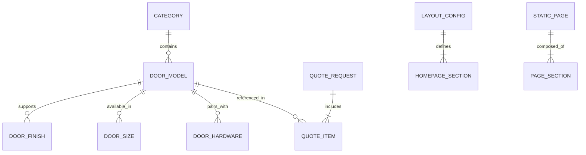

# Architecture Documentation: Catalog & Data Models Specification

This document details the complete data schemas, entities, and relationship models required to drive the door catalog, the layout builder, the static page CMS, and the quote lead management system.

---

## 1. Entity-Relationship Overview



---

## 2. Core Entities Specification

### 2.1 Category Model (`Category`)
Categories structure the catalog navigation (e.g., *Modern Interior Doors*, *Frameless Doors*, *Front Doors*, *Barn Doors*, *Pocket Doors*).

```typescript
interface Category {
  id: string;                  // e.g. "cat-modern-interior"
  name: string;                // "Modern Interior Doors"
  slug: string;                // "modern-interior-doors"
  description: string;         // "Sleek, minimalist interior doors designed for contemporary spaces."
  bannerImage: string;         // URL or relative path to high-res header image
  badge?: string;              // "Popular" | "Sale" | "New" | null
  order: number;               // Ordering weight in navigation (0, 1, 2...)
  isActive: boolean;           // Visibility toggle
  metaTitle: string;
  metaDescription: string;
}
```

---

### 2.2 Door Model (`DoorModel`)
Represents an individual door product in the catalog. At initial launch, no checkout will occur; each door model is designed for interactive visual configuration and quotation.

```typescript
interface DoorModel {
  id: string;                  // e.g. "door-frameless-filo"
  categoryId: string;          // Foreign key to Category
  name: string;                // "Filo Concealed Frameless Door"
  slug: string;                // "filo-concealed-frameless-door"
  sku: string;                 // "DLA-FRM-001"
  tagline: string;             // "Zero-jamb minimalist door that sits flush with drywall"
  description: string;         // Full rich-text or markdown description
  
  // Pricing Strategy (No purchase at start)
  displayPrice: boolean;       // If true, shows price; if false, shows "Request a Quote"
  priceStartingAt: number;     // e.g. 849 (USD)
  compareAtPrice?: number;     // e.g. 999 (for sale display)
  
  // Badges & Status
  badges: string[];            // ["Best Seller", "In Stock", "Sale"]
  isFeatured: boolean;         // Featured on homepage
  isBestSeller: boolean;       // Shown in best seller carousels
  status: "active" | "draft" | "archived";
  
  // Visual Media
  primaryImage: string;        // Main preview image
  galleryImages: string[];     // Additional gallery & architectural context shots
  specSheetPdfUrl?: string;    // Direct link to technical architectural spec sheet
  
  // Configurable Door Attributes
  availableFinishes: FinishOption[];
  availableSizes: SizeOption[];
  availableCores: CoreOption[];
  availableFrames: FrameOption[];
  availableHardware: HardwareOption[];

  // SEO
  metaTitle?: string;
  metaDescription?: string;
}
```

#### Attribute Sub-schemas:
```typescript
interface FinishOption {
  id: string;
  name: string;                // "Matte Pure White", "Smoked Walnut Veneer", "Anthracite Gray"
  type: "paint" | "veneer" | "laminate" | "enamel";
  hexCode?: string;            // "#F4F5F7"
  textureImage?: string;       // High-res swatch image URL
  isDefault: boolean;
}

interface SizeOption {
  id: string;
  width: string;               // e.g. "28\"", "30\"", "32\"", "36\""
  height: string;              // e.g. "80\"", "84\"", "96\""
  thickness: string;           // e.g. "1-3/4\""
  isStandard: boolean;
}

interface CoreOption {
  id: string;
  name: string;                // "Solid Core (Acoustic 34dB)", "Honeycomb Core", "Solid Wood"
  description: string;
}

interface FrameOption {
  id: string;
  name: string;                // "Concealed Aluminum Flush Jamb", "Pre-hung Wood Jamb", "Bypass Track"
  type: "frameless" | "prehung" | "sliding";
}

interface HardwareOption {
  id: string;
  name: string;                // "3D Adjustable Concealed Hinges + Magnetic Latch"
  finish: string;              // "Matte Black", "Satin Chrome", "Brushed Brass"
  image?: string;
}
```

---

### 2.3 Layout Configuration (`LayoutConfig`)
The Admin panel allows full control over which sections appear on the homepage, their visual layout style, and their display order.

```typescript
interface LayoutConfig {
  hero: {
    enabled: boolean;
    slides: HeroSlide[];
    autoplaySpeedMs: number;
  };
  promoBanner: {
    enabled: boolean;
    message: string;           // "Wholesale Interior Doors in Los Angeles - Fast California Delivery"
    linkText?: string;         // "Explore Sale"
    linkUrl?: string;          // "/catalog/sale"
    backgroundColor: string;   // "#E53935"
  };
  sectionsOrder: string[];     // ["hero", "categories", "featured", "finishes", "services", "quote_cta"]
  homepageSections: {
    [key: string]: {
      enabled: boolean;
      title: string;
      subtitle?: string;
      displayStyle: "grid" | "carousel" | "masonry" | "swatches";
      itemLimit: number;
    };
  };
}

interface HeroSlide {
  id: string;
  title: string;               // "Modern European & Frameless Doors"
  subtitle: string;            // "Custom engineered for luxury architectural interiors."
  imageUrl: string;
  primaryButtonText: string;   // "Explore Catalog"
  primaryButtonLink: string;   // "/catalog"
  secondaryButtonText: string; // "Request Free Quote"
  secondaryButtonLink: string; // "#quote-modal"
  badgeText?: string;          // "Wholesale Prices in Los Angeles"
}
```

---

### 2.4 Static Pages (`StaticPage`)
Content managers can create and edit static pages such as *About Us*, *Showroom & Location*, *Installation Services*, and *2-Year Warranty*.

```typescript
interface StaticPage {
  id: string;
  slug: string;                // "about", "showroom", "installation", "warranty", "contact"
  title: string;               // "About Doors Los Angeles"
  subtitle?: string;
  heroImage?: string;
  sections: StaticPageSection[];
  isPublished: boolean;
  metaTitle: string;
  metaDescription: string;
  updatedAt: string;
}

interface StaticPageSection {
  id: string;
  type: "text_block" | "two_column_image_text" | "feature_cards" | "map_location" | "faq_accordion";
  heading?: string;
  contentHtml: string;
  imageUrl?: string;
  imagePosition?: "left" | "right" | "top";
  items?: { title: string; body: string; icon?: string }[];
}
```

---

### 2.5 Quote Request Lead (`QuoteRequest`)
Since direct online checkout is not active, this model captures lead information and the exact doors/specifications requested by customers.

```typescript
interface QuoteRequest {
  id: string;                  // e.g. "quote-20261119-001"
  createdAt: string;           // ISO timestamp
  status: "new" | "contacted" | "quoted" | "closed" | "archived";
  
  // Customer Details
  customerName: string;
  customerEmail: string;
  customerPhone: string;
  projectCity: string;         // e.g. "Los Angeles, CA"
  projectType: "Residential" | "Commercial" | "Designer / Architect" | "Contractor";
  estimatedQuantity: string;   // "1-5 doors", "6-15 doors", "15+ doors"
  notes?: string;

  // Items requested
  items: QuoteItem[];
}

interface QuoteItem {
  doorId: string;
  doorName: string;
  selectedFinish?: string;
  selectedSize?: string;
  selectedFrame?: string;
  selectedHardware?: string;
  quantity: number;
}
```

---

### 2.6 Site Settings (`SiteSettings`)
Global company and branding configuration editable from the Admin panel:

```typescript
interface SiteSettings {
  companyName: string;         // "Doors Los Angeles"
  tagline: string;             // "Wholesale Modern Interior & Exterior Doors"
  logoUrl: string;
  phone: string;               // "(424) 426-5566"
  email: string;               // "sales@doorslosangeles.com"
  showroomAddress: {
    street: string;            // "1660 W 139th Street"
    city: string;              // "Gardena"
    state: string;             // "CA"
    zip: string;               // "90249"
    fullText: string;          // "1660 W 139th Street, Gardena, Los Angeles, CA 90249"
  };
  workingHours: string;        // "Monday - Friday: 9:00 AM - 5:00 PM"
  catalogPdfUrl: string;       // Direct download URL for showroom catalog PDF
  socialLinks: {
    instagram?: string;
    facebook?: string;
    linkedin?: string;
    youtube?: string;
  };
}
```
