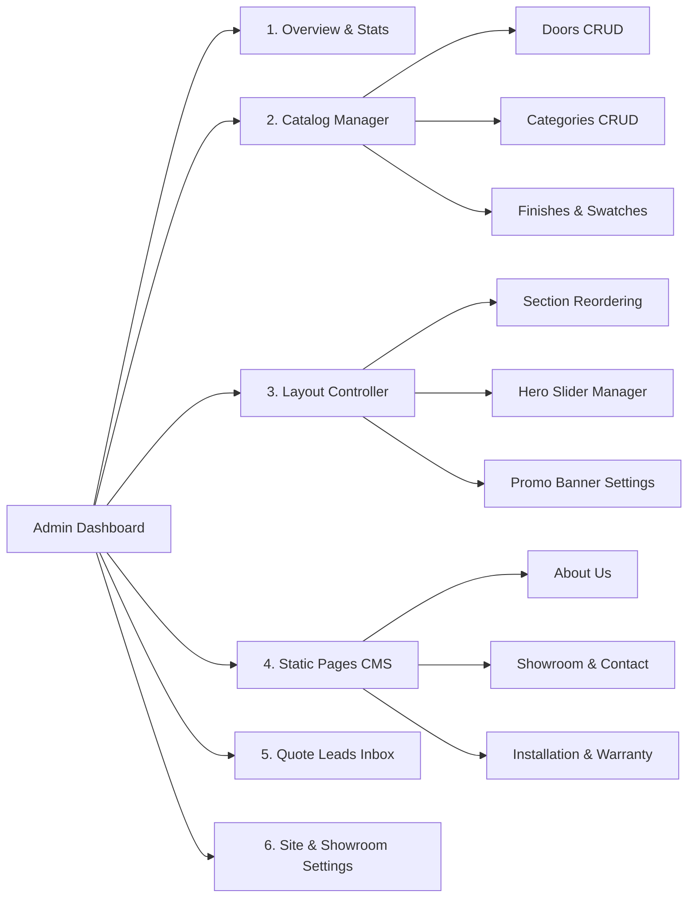

# Architecture Documentation: Admin Panel & CMS Specification

This document details the functional and architectural specifications for the **Admin Control Panel**, providing complete administrative power over:
1. **Catalog Management** (Door models, categories, finishes, hardware, spec sheets)
2. **Layout & Homepage Control** (Hero slider, section order, promotional banners, feature toggles)
3. **Static Page CMS** (About Us, Showroom & Location, Installation, Warranty, FAQ)
4. **Quote Leads Inbox** (Customer quote inquiries, item specs, status workflow)
5. **Global Site & Showroom Settings** (Phone numbers, address, hours, catalog PDF)

---

## 1. Admin Layout & Navigation Hierarchy

### 1.1 Shell Interface Elements
- **Sidebar**: Fixed left navigation with icon-tagged routes, badge counter for *New Quotes*, and collapsible state for compact displays.
- **Top Bar**: Search bar, current view title, quick link: `👁️ View Live Front Site` (opens client front in new tab), and data backup/reset options.
- **Content Area**: High-density responsive card-based layout with action headers (e.g. `+ Add New Door`, `Save Layout`, `Export Inquiries`).

---

## 2. Module Specifications

### 2.1 Dashboard Overview (`/admin/dashboard`)
- **Key Metrics (KPI Cards)**:
  * Total Door Models (Active / Draft)
  * Categories Count
  * Pending Quote Requests (highlighted in red if new)
  * Top Viewed Models
- **Quick Actions**:
  * "Create New Door Model"
  * "Edit Hero Slider"
  * "Review Recent Quote Inquiries"
- **Recent Leads Preview**: Compact table showing the 5 most recent customer quote submissions with 1-click status updates.

---

### 2.2 Catalog Management (`/admin/catalog`)

#### A. Door Products Table & Filters
- **Table Columns**: Preview Thumbnail, Door Name, SKU, Category, Base Price (or "Quote Only"), Badges (`Sale`, `Best Seller`), Status (`Active`/`Draft`), Actions (`Edit`, `Duplicate`, `Delete`).
- **Filter Bar**: Filter by category, status, search by name/SKU, sort by order/price/date.

#### B. Door Model Editor Modal / Page
- **Basic Info Tab**:
  * Name, Slug (auto-generated or custom), SKU, Category dropdown.
  * Tagline and Detailed Rich Description.
- **Pricing & Badges Tab**:
  * "Display Price on Frontend" toggle (if disabled, displays prominent "Request Quote" button).
  * Base Price (USD) and Compare-At Price (for sale discounts).
  * Badge checkboxes: `Best Seller`, `Sale`, `In Stock`, `New Arrival`, `Custom Only`.
- **Media & Gallery Tab**:
  * Primary Thumbnail URL / file upload.
  * Gallery Images manager (add multiple images, reorder drag-and-drop).
  * Spec Sheet PDF link (direct URL to download technical PDF).
- **Configurations & Attributes Tab**:
  * Finishes checklist (select supported wood veneers, matte lacquers, enamel colors).
  * Sizes selector (Standard heights 80", 84", 96" and widths 24" to 36", plus "Custom Sizes Available" toggle).
  * Jamb / Frame systems (Concealed frameless jamb, pre-hung jamb, pocket door kit, barn door track).
  * Hardware options (Concealed 3D hinges, magnetic silent locks, Italian designer lever handles).

#### C. Categories & Collections Manager
- List of categories with drag-and-drop ordering.
- Add/Edit Category: Name, Slug, Description, Header Banner image, and Navigation Badge.

#### D. Global Finishes & Swatches Library
- Centralized palette of available finishes (e.g. *Smoked Oak*, *Walnut*, *Matte White RAL 9003*, *Anthracite*, *Brushed Gold Hardware*).
- Allows adding color hex codes or high-res woodgrain texture image swatches that automatically populate door customizers on the front end.

---

### 2.3 Layout & Homepage Controller (`/admin/layout`)
The user requested full control over the webpage layout:

#### A. Section Order & Visibility Controller
- Drag-and-drop list of homepage sections:
  1. `Top Promo Banner` (Sticky announcement header)
  2. `Hero Slider / Banner Showcase`
  3. `Popular Categories Grid`
  4. `Best Sellers Spotlight Carousel`
  5. `Frameless & Custom Doors Feature Row`
  6. `Finishes & Materials Explorer`
  7. `Services & Showroom Value Props (Warranty, Installation)`
  8. `Bottom Quote / Consultation CTA`
- Each section includes an **Active/Inactive switch** and customizable section heading and subheading.

#### B. Hero Slider Manager
- Add, edit, or remove slides.
- Per-slide settings:
  * Main Headline (e.g., *"Modern European & Frameless Doors"*).
  * Subheadline (e.g., *"Wholesale Architectural Doors in Gardena & Los Angeles"*).
  * Background image preview.
  * Primary Call to Action: Label & Link (e.g. *"Explore Catalog"* -> `/catalog`).
  * Secondary Call to Action: Label & Link (e.g. *"Request Free Quote"* -> opens Quote Modal).
  * Badge tag (e.g., *"Wholesale Direct"*).

#### C. Promo Announcement Bar
- Text message (e.g., *"Wholesale Interior Doors in Gardena, LA. Fast Delivery Across California!"*).
- Background color picker (default signature red `#E53935`).
- Optional link button (e.g., *"View Sale"*).
- Enable / disable toggle.

---

### 2.4 Static Pages CMS (`/admin/pages`)
Allows complete editing of static content without writing code:

- **Supported Static Pages**:
  1. **About Us** (`/about`): Company history, wholesale mission, craftsmanship, warehouse/showroom photos.
  2. **Showroom & Contact** (`/showroom`): Physical showroom details (1660 W 139th Street, Gardena), embedded map view, hours of operation, appointment booking.
  3. **Door Installation** (`/installation`): Step-by-step installation services, contractor partnerships, prehung vs frameless installation guides.
  4. **2-Year Warranty** (`/warranty`): Detailed warranty terms, manufacturer specifications, care & maintenance guide.
  5. **FAQ / Help** (`/faq`): Frequently asked questions accordion (Sizing, shipping lead times, custom finishes, frameless installation).

- **Page Editor Features**:
  * Hero banner image & title editor.
  * Modular content blocks: Rich text sections, two-column image + text cards, feature grid boxes, and accordion FAQs.
  * SEO Settings: Meta Title and Meta Description for search engines.

---

### 2.5 Quote Leads & Inquiries Manager (`/admin/quotes`)
Because direct purchases are disabled at start, quote lead capture is the primary conversion channel:

- **Lead Listing**:
  * Status filter: `All`, `New` (pill), `Contacted`, `Quoted`, `Closed`, `Archived`.
  * Columns: Quote ID, Customer Name, Phone, Email, Project City, Items Count, Date, Status.
- **Lead Detail Drawer**:
  * Full customer info (Name, Phone, Email, City, Contractor/Homeowner type).
  * Itemized requested doors: Door Model, Selected Finish, Selected Size, Frame type, Quantity.
  * Customer Notes / Project details.
  * Admin Action Buttons:
    - Change Status (`New` -> `Contacted` -> `Quoted` -> `Closed`)
    - "Call Customer" (`tel:` link)
    - "Email Customer" (`mailto:` link with pre-filled quote template)
    - "Export to CSV / Print Spec Sheet"

---

### 2.6 Site & Showroom Settings (`/admin/settings`)
Global brand information:
- **Showroom Phone**: `(424) 426-5566`
- **Sales Email**: `sales@doorslosangeles.com`
- **Showroom Address**: `1660 W 139th Street, Gardena, Los Angeles, CA 90249`
- **Hours of Operation**: `Monday - Friday: 9:00 AM - 5:00 PM`
- **Catalog PDF Link**: URL to downloadable digital PDF catalog.
- **Social Channels**: Instagram, Facebook, LinkedIn, YouTube URLs.
- **Backup & Reset**:
  * `Export Database (JSON)`: Download full site catalog and configuration.
  * `Import Database (JSON)`: Restore database from file.
  * `Reset to Showroom Defaults`: Restores initial showroom data set.
