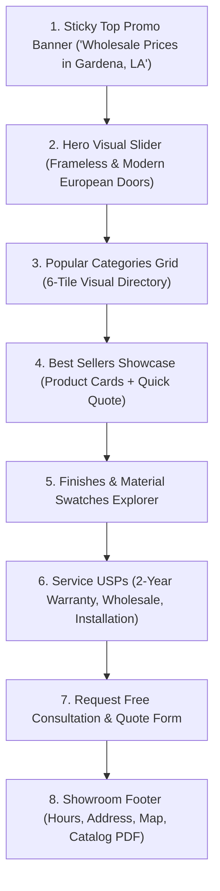
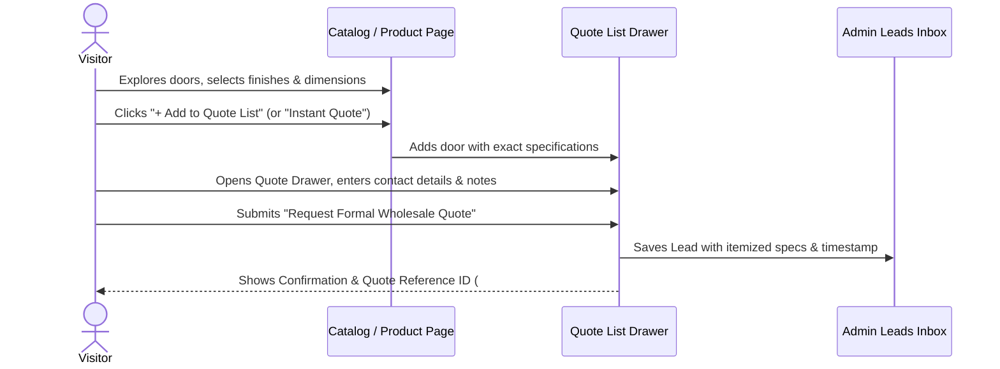

# Architecture Documentation: Frontend UI/UX Specification

This specification defines the visual hierarchy, component system, responsive design, and user journey for the public-facing **Catalog Website**, styled after **Doors Los Angeles** ([doorslosangeles.com](https://doorslosangeles.com)) with luxury touches from **Interior Doors Co** and **Urban Doors Company**.

---

## 1. Visual Identity & Design Tokens

### 1.1 Color System
| Role | Color Name | Hex Code | Purpose |
|---|---|---|---|
| **Accent / CTA** | Cardinal Red | `#E53935` | "SALE" button, inquiry CTA, active nav borders, badges |
| **Accent Dark** | Deep Crimson | `#B71C1C` | Hover states on buttons, active badges |
| **Dark Neutral** | Architectural Charcoal | `#111111` / `#2D2D2D` | Primary headings, logos, dark buttons, footers |
| **Body Text** | Slate Muted | `#555555` / `#666666` | Paragraphs, specifications, secondary descriptions |
| **Light Neutral** | Studio Light Gray | `#F4F5F8` | Section backgrounds, card containers, mega menus |
| **Border Neutral** | Fine Border Gray | `#E8E8E8` | Card dividers, table borders, input outlines |
| **Pure White** | Canvas White | `#FFFFFF` | Primary content backgrounds, card surfaces |

### 1.2 Typography
- **Primary Headings & Body**: `Inter`, `-apple-system`, `BlinkMacSystemFont`, `Segoe UI`, `Roboto`, `sans-serif`. Clean, high-legibility, geometric.
- **Editorial / Luxury Accents**: `Georgia`, `Times New Roman`, `serif` for luxury hero titles and showcase section headings (inspired by *Interior Doors Co*).
- **Navigation & Badges**: Uppercase, letter-spacing `0.08em` to `0.15em`, font-weight `600` / `700`.

---

## 2. Header & Navigation Architecture

```
+------------------------------------------------------------------------------------------------+
|  Top Utility Bar: [Installation] [2-Year Warranty]   |   [Download Catalog] [Portfolio] [LA, CA v]   |
+------------------------------------------------------------------------------------------------+
|  Main Header: [ DOORS LOS ANGELES ]    [ 🔍 Search Products... ]   [ SALE % ]  (424) 426-5566  [📋 Quote List (3)] |
+------------------------------------------------------------------------------------------------+
|  Mega Menu: MODERN INTERIOR DOORS v | FRONT DOORS v | BEST SELLERS | FRAMELESS | CUSTOM | FINISHES |
+------------------------------------------------------------------------------------------------+
```

### 2.1 Top Utility Bar
- **Left Links**: Quick access to *Installation Services* and *2-Year Warranty*.
- **Right Links**: Direct *Download Catalog (PDF)* link, *Portfolio / Gallery*, and Showroom Location indicator (*Los Angeles, CA*).

### 2.2 Main Header (Sticky on Scroll)
- **Showroom Logo**: Vector architectural wordmark.
- **Search Bar**: Real-time auto-complete showing door models with mini-thumbnails and category tags.
- **Phone Action**: Clickable `tel:4244265566` displayed prominently in bold typography.
- **SALE Badge Button**: Direct link to promotional & discount items with signature red background.
- **Quote List Icon ("Cart-as-Quote")**: Displays the count of doors added to the quote list. Clicking opens the **Quote Inquiry Drawer**.

### 2.3 Mega Menu Navigation
- Hovering or clicking categories displays an architectural mega menu with categorized door systems:
  * *Swinging Doors*
  * *Frameless / Concealed Doors*
  * *Pocket Doors & Double Pocket*
  * *Barn Doors & Concealed Barn*
  * *Bi-fold Doors & Bypass Closet Doors*
  * *Prehung vs. Slab Doors*
  * Visual thumbnail cards featuring top-selling models in that category.

---

## 3. Homepage Layout Modules (Layout-Driven)



### 3.1 Hero Visual Slider
- High-resolution architectural photography of modern interior spaces.
- Dynamic typography: Headline, tagline, wholesale badge.
- Primary CTA: **"Explore Catalog"** (smoothly navigates to door collection).
- Secondary CTA: **"Request Free Quote"** (opens quote consultation modal).

### 3.2 Popular Categories Grid
- Responsive 3-column / 6-card grid with high-aspect architectural photography:
  1. *Frameless & Concealed Jamb Doors*
  2. *Modern Interior Swing Doors*
  3. *Sliding Barn & Pocket Doors*
  4. *Luxury Front & Exterior Entry Doors*
  5. *Custom Double Swing & Bifold Doors*
  6. *Italian Hardware & Concealed Hinges*

### 3.3 Best Sellers Showcase
- Product card components:
  * High-res door photo with subtle zoom hover effect.
  * Badges: `Best Seller`, `In Stock`, or `Sale`.
  * Door Title, SKU, and Category.
  * Price Display (e.g. *"Starting at $849"* or *"Request Wholesale Quote"* based on Admin setting).
  * Quick Actions: **"View Details & Customize"** and **"+ Add to Quote List"**.

### 3.4 Finishes & Material Swatches Explorer
- Interactive visual swatch bar:
  * Natural Veneers: Smoked Oak, Walnut, Natural Wenge, Teak.
  * Premium Enamels & Painted: Pure White (RAL 9003), Soft Gray, Anthracite, Jet Black.
  * Acoustic & Core Cutaways: Solid core illustration showcasing sound isolation (34 dB).
  * Customers can click any finish to see matching door models.

### 3.5 Services & Value Proposition
- 4-column value proposition row:
  1. **Direct Wholesale Pricing**: Direct importer and manufacturer savings.
  2. **2-Year Manufacturer Warranty**: Comprehensive quality guarantee.
  3. **Fast Delivery**: In-stock models delivered across California within 2-5 days.
  4. **Professional Installation**: Experienced technicians for frameless and prehung systems.

---

## 4. Product Catalog & Filter Experience (`/catalog`)

### 4.1 Multi-Faceted Filter Sidebar
- **Category Filter**: Checkboxes for Door Categories.
- **Door System**: Swinging, Frameless, Pocket, Barn, Bifold, Bypass.
- **Finishes**: Color swatches (White, Wood, Black, Gray, Custom).
- **Dimensions**: Heights (80", 84", 96"), Widths (24", 28", 30", 32", 36", 42", Custom).
- **Availability**: "In Stock Only", "Sale Items Only".

### 4.2 Interactive Door Detail & Customizer (`/doors/:slug`)
- **Left Column**: Multi-image gallery with zoom lens and architectural interior context shots.
- **Right Column (Interactive Customizer)**:
  * Door Title, SKU, Rating, Tagline.
  * Price Indicator (or "Wholesale Quote Available").
  * **Finish Selector**: Clickable color/wood swatches that update the active selection.
  * **Size Options**: Standard sizing chips (80" x 30", 80" x 32", 84" x 36", 96" x 36") and "Custom Size" input.
  * **Frame System Selector**: Concealed Frameless Aluminum Jamb vs. Prehung Jamb.
  * **Core Selection**: Solid Core Acoustic vs. Standard.
  * **Hardware Selection**: Magnetic Lock + 3D Concealed Hinges finish options.
  * **Action Buttons**:
    - `📋 Add to Quote List`
    - `⚡ Request Instant Quote for This Model`
    - `📄 Download Architectural Spec Sheet (PDF)`

---

## 5. Quote Request System ("No Purchase at Start" Workflow)



- When the customer submits the quote request:
  1. A confirmation message displays the unique Quote Reference Number.
  2. The submission instantly registers in the **Admin Panel > Quote Leads Inbox**.
  3. The customer receives guidance on showroom visit or phone callback within 1 business day.
