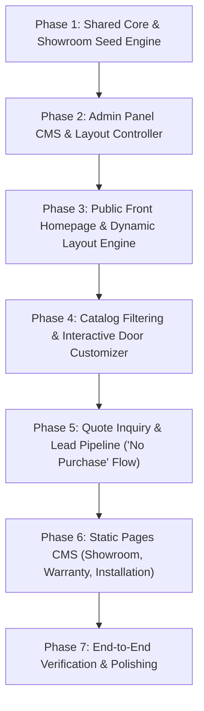

# Architecture Documentation: Vibecoding Implementation Guide

This guide establishes the step-by-step modular blueprint to build the complete door catalog and CMS platform using **vibecoding** (iterative, prompt-guided human-AI pair programming).

---

## 1. Project Directory Structure

```
Web page builder/
├── architecture/                     # Architectural documentation (these blueprints)
│   ├── 01-SYSTEM-ARCHITECTURE.md
│   ├── 02-CATALOG-AND-DATA-MODELS.md
│   ├── 03-ADMIN-PANEL-SPECIFICATION.md
│   ├── 04-FRONTEND-UIUX-SPECIFICATION.md
│   ├── 05-VIBECODING-IMPLEMENTATION-GUIDE.md
│   └── README.md
├── index.html                        # Gateway switcher (links to Front & Admin)
├── front/                            # Public-facing Catalog Website
│   ├── index.html                    # Homepage (Layout-driven)
│   ├── catalog.html                  # Product Catalog with Filters
│   ├── door.html                     # Interactive Door Detail & Customizer
│   ├── page.html                     # Dynamic Static Page Renderer (About, Warranty, Installation)
│   ├── css/
│   │   ├── style.css                 # Frontend styling & responsive layouts
│   │   └── components.css            # Header, mega menu, swatches, modals
│   ├── js/
│   │   ├── main.js                   # Homepage layout engine
│   │   ├── catalog.js                # Multi-faceted filter engine
│   │   ├── door-detail.js            # Door finish/size/frame interactive customizer
│   │   └── quote-cart.js             # Quote list drawer & lead submission
│   └── assets/                       # High-res door photos, swatch textures, icons
├── admin/                            # Admin Control Panel
│   ├── index.html                    # Dashboard Overview & Stats
│   ├── catalog.html                  # Catalog Management (Doors, Categories, Finishes)
│   ├── layout.html                   # Layout & Homepage Section Controller
│   ├── pages.html                    # Static Pages CMS
│   ├── quotes.html                   # Quote Leads Inbox
│   ├── settings.html                 # Showroom & Site Settings
│   ├── css/
│   │   └── admin.css                 # Admin styling (sidebar, tables, forms, badges)
│   └── js/
│       ├── admin.js                  # Admin common shell & navigation
│       ├── admin-catalog.js          # Catalog CRUD logic
│       ├── admin-layout.js           # Drag-and-drop / section ordering logic
│       ├── admin-pages.js            # Page builder logic
│       ├── admin-quotes.js           # Quote lead management & CSV export
│       └── admin-settings.js         # Settings & backup/restore logic
└── shared/                           # Shared Architecture & Data Layer
    ├── css/
    │   └── variables.css             # Design tokens (colors, typography, spacing)
    ├── js/
    │   ├── store.js                  # Unified LocalStorage / IndexedDB data store
    │   ├── seed-data.js              # Complete showroom dataset (Doors LA quality)
    │   └── utils.js                  # Formatting, slug generators, helpers
    └── assets/                       # Shared branding icons & PDF catalogs
```

---

## 2. Vibecoding Implementation Phases



---

### Phase 1: Shared Core & Showroom Seed Engine
**Goal**: Build `shared/js/store.js` and `shared/js/seed-data.js` to create the persistent single source of truth.
- **Key Deliverables**:
  1. `shared/css/variables.css`: All CSS variables for colors (cardinal red, charcoal, studio gray), fonts, spacing, shadows.
  2. `shared/js/seed-data.js`: Rich seed data replicating **Doors Los Angeles**:
     - Categories: *Modern Interior Doors*, *Frameless Doors*, *Front Doors*, *Barn Doors*, *Pocket Doors*.
     - 12+ detailed door models (*Filo Concealed*, *European Flush Oak*, *Classic 3-Panel*, *Contemporary Pivot Entry*).
     - Finishes: Smoked Walnut, Bleached Oak, Matte Pure White, Anthracite Gray.
     - Sizes: 80"x30", 84"x32", 96"x36".
     - Static pages: About Us, Showroom & Location, Installation, 2-Year Warranty.
     - Showroom settings: `(424) 426-5566`, 1660 W 139th St, Gardena, CA.
  3. `shared/js/store.js`: CRUD methods with auto-seeding on first launch:
     - `getCatalog()`, `saveDoor(door)`, `deleteDoor(id)`
     - `getLayout()`, `saveLayout(layoutConfig)`
     - `getPages()`, `savePage(page)`
     - `getQuotes()`, `saveQuote(quote)`, `updateQuoteStatus(id, status)`
     - `getSettings()`, `saveSettings(settings)`
     - `exportDatabase()`, `importDatabase(json)`

---

### Phase 2: Admin Panel CMS & Layout Controller
**Goal**: Build the operational dashboard so any changes immediately reflect on the front end.
- **Key Deliverables**:
  1. `admin/index.html`: Dashboard showing metrics (Active Doors, Categories, New Quote Inquiries).
  2. `admin/catalog.html`: Table of all doors with thumbnail, category, price/quote status, badges (`Best Seller`, `Sale`). Modal to create/edit door models, finishes, sizes, frame systems, and specs.
  3. `admin/layout.html`:
     - Section order manager (reorder Hero, Categories, Best Sellers, Finishes, Services, Lead CTA).
     - Section visibility toggles.
     - Hero slider editor (title, subtitle, buttons, images).
     - Top promo banner text & color editor.
  4. `admin/quotes.html`: Quote inquiries inbox with customer contact details, door specifications, and status progression (`New` -> `Contacted` -> `Quoted` -> `Closed`).

---

### Phase 3: Public Front Homepage & Dynamic Layout Engine
**Goal**: Build the client front homepage that dynamically renders sections according to the Admin's layout settings.
- **Key Deliverables**:
  1. `front/index.html` + `front/css/style.css` + `front/js/main.js`.
  2. Top Promo Announcement Banner (with toggle from Admin).
  3. Top utility bar & Sticky Header with search, phone link `(424) 426-5566`, and Quote Cart badge.
  4. Mega Menu with door categories and subcategories.
  5. Dynamic Hero Slider with transition animations and direct CTAs.
  6. Popular Categories Grid (responsive tiles with hover animations).
  7. Best Sellers Carousel/Grid with live badges.
  8. Interactive Architectural Finishes Swatch Explorer.
  9. Services Row (Installation, 2-Year Warranty, Wholesale Prices).
  10. Showroom Footer with hours, address, phone, and downloadable PDF catalog link.

---

### Phase 4: Product Catalog, Filters & Interactive Customizer
**Goal**: Allow visitors to search and visually customize doors.
- **Key Deliverables**:
  1. `front/catalog.html` + `front/js/catalog.js`:
     - Real-time faceted sidebar filter: Categories, Door Systems (Frameless, Swing, Pocket, Barn), Finishes, Sizing, Badges.
     - Search query filtering and sorting (Price low-to-high, high-to-low, popular).
     - Responsive door product grid.
  2. `front/door.html` + `front/js/door-detail.js`:
     - Image gallery with main zoom and thumbnails.
     - Interactive finish selector (swatches change active color/texture).
     - Sizing selector (80", 84", 96").
     - Frame system selector (Concealed Frameless Aluminum Jamb vs. Prehung).
     - Hardware selector (3D concealed hinges, magnetic latch).
     - "Request Instant Quote for This Model" button.
     - "+ Add to Quote List" button.
     - "Download Spec Sheet (PDF)" button.

---

### Phase 5: Quote Inquiry & Lead Pipeline ("No Purchase" Flow)
**Goal**: Provide a frictionless quote collection experience without requiring payment.
- **Key Deliverables**:
  1. `front/js/quote-cart.js`:
     - Persistent Quote List drawer (accessible from header on any page).
     - Item cards showing customized door model, selected finish, size, frame, and quantity.
     - Customer details submission form: Name, Phone, Email, Project City/Zipcode, Contractor/Homeowner status, Notes.
  2. Instant Quote Modal:
     - 1-click modal on product page for single-door quick inquiries.
  3. Confirmation Screen:
     - Emits a unique Quote Reference Code (e.g. `#Q-LA-1082`).
     - Automatically saves to `shared/js/store.js` -> instantly visible in `admin/quotes.html`.

---

### Phase 6: Static Pages CMS (Showroom, Warranty, Installation)
**Goal**: Dynamic rendering of rich static pages from data managed in Admin.
- **Key Deliverables**:
  1. `front/page.html`: Dynamically loads content by URL slug (`?page=about`, `?page=showroom`, `?page=installation`, `?page=warranty`).
  2. Showroom page includes physical location details (1660 W 139th St, Gardena, LA), Google Map embed, and consultation scheduling form.
  3. Installation page showcases prehung vs frameless jamb preparation guides.
  4. 2-Year Warranty page details coverage specifications and care instructions.

---

### Phase 7: Verification & Polishing
- Test Admin modifications (reordering layout, editing banner, adding a new door model) and verify they reflect instantly on the Front website.
- Test Quote submission flow from both product page and multi-item quote cart.
- Verify full responsive layout on mobile, tablet, and desktop viewports.
